# Toah Nipi Blog: Staff Guide

This guide shows you how to post stories to the **New!** page of the Toah Nipi website. Each post is a PDF, for example a newsletter or story exported from Canva, Word or Google Docs. You don't need any technical knowledge.

The pictures come from the real blog editor, filled in with made-up examples such as "Sample Retreat Update". Orange numbers in the pictures match the numbered steps.

**Contents**

1. [Quick start: publish a post](#quick-start-publish-a-post)
2. [Opening the staff editor](#1-opening-the-staff-editor)
3. [Signing in and signing out](#2-signing-in-and-signing-out)
4. [Creating a post](#3-creating-a-post)
5. [Saving a draft](#4-saving-a-draft)
6. [Publishing](#5-publishing)
7. [Editing a published post](#6-editing-a-published-post)
8. [Unpublishing](#7-unpublishing)
9. [Deleting](#8-deleting)
10. [Using a phone](#9-using-a-phone)
11. [Troubleshooting](#10-troubleshooting)

---

## Quick start: publish a post

1. Go to **toahnipi.org/staff/blog** (or click **Staff** at the very bottom of any page).
2. Type your **Email** and **Password**, then click **Sign in**.
3. Click **New post**.
4. Type a **Title** and, if you like, a **Short description**.
5. Under **PDF**, click **Choose File** and pick your PDF.
6. Click **Save and publish**.
7. Wait for the green message "…is now on the website." That's it.

Before you publish, read through your PDF once more. Check the spelling, dates, names and photos, and make sure everyone pictured is happy to appear on the website.

### Which button do I need?

| Button | What it does | Can visitors see the post? | Can I undo it? |
| --- | --- | --- | --- |
| **Save draft** | Saves your work privately so you can finish it later. | No | Yes. Publish it whenever you're ready. |
| **Save and publish** / **Publish** | Puts the post on the New! page. | Yes | Yes. Use **Unpublish**. |
| **Unpublish** | Takes the post off the website but keeps it in your list as a draft. | No | Yes. Use **Publish** again. |
| **Delete** | Removes the post and its PDF permanently. | No | **No.** It can't be brought back. |

If you're unsure, choose **Unpublish** rather than **Delete**.

---

## 1. Opening the staff editor

The website has two parts:

- **The public blog** is the **New!** page (toahnipi.org/new). Everyone can see it.
- **The staff editor** (toahnipi.org/staff/blog) is where you add and change posts. Only people with a staff account can use it.

**To open the staff editor:**

1. Scroll to the very bottom of any page on toahnipi.org.
2. Click **Staff** (1), next to **Privacy** and **Accessibility**.

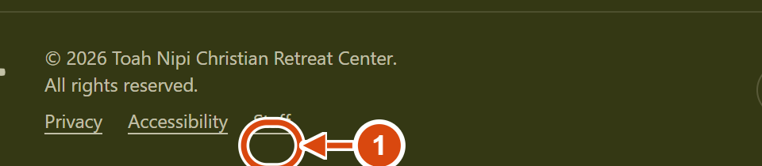

You can also type **toahnipi.org/staff/blog** into your browser and bookmark it.

> **For the administrator:** the staff editor goes live at this address when the update is published to the live website. Until then it's only on the test (preview) version.

---

## 2. Signing in and signing out

Sign-in uses only your **email and password**; no code or app is needed. The site administrator creates staff accounts. There's no way to sign up yourself.

### Signing in

1. Type your email address in **Email** (1).
2. Type your password in **Password** (2). The dots hide what you type.
3. Click **Sign in** (3).

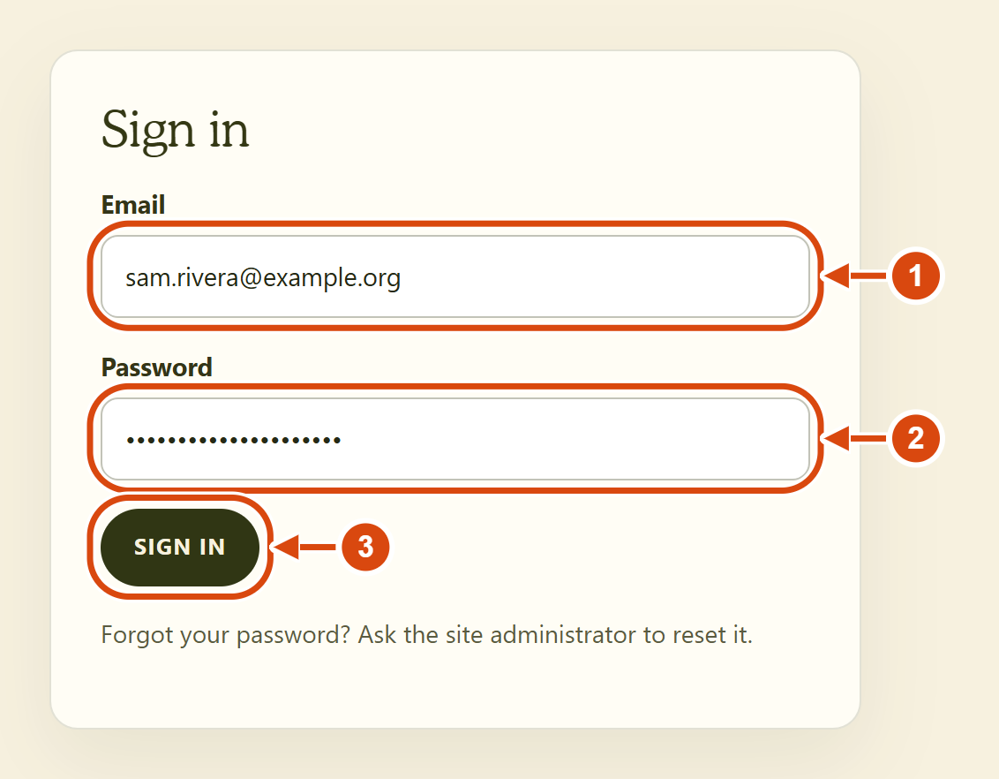

After you sign in, you'll see **Blog Editor** at the top with your email address, and a list called **Posts**.

**The first time you sign in,** you'll be using a temporary password from the administrator. Change it straight away (see [Changing your password](#changing-your-password)).

**If your email or password is wrong,** you'll see "Incorrect email or password." Check for typing mistakes and try again.

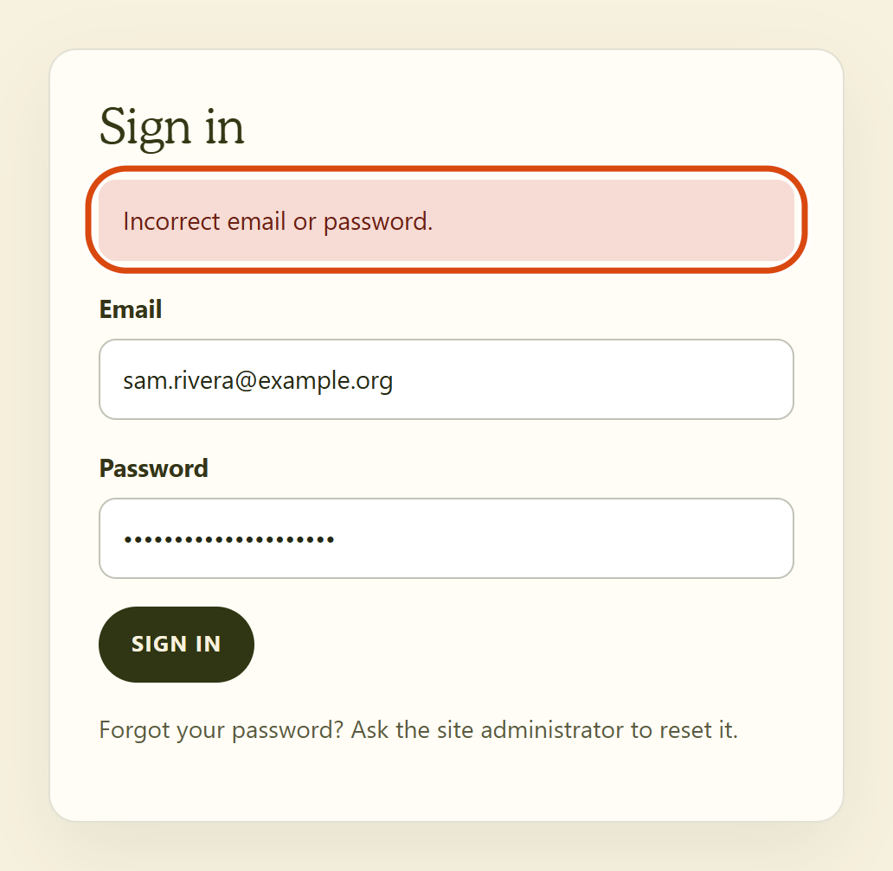

**If you've forgotten your password,** ask the site administrator to reset it. They'll give you a new temporary password.

**If you see "This account doesn't have access to manage blog posts,"** you're signed in, but your account hasn't been allowed to manage the blog yet. Ask the site administrator.

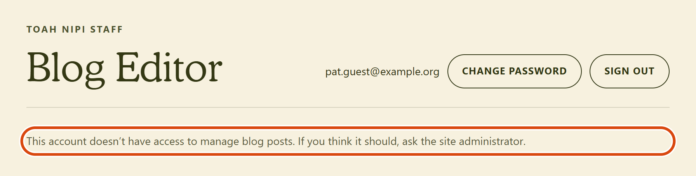

### Changing your password

1. Click **Change password** (1) at the top of the page.
2. Type your new password in **New password** (1 in the second picture). Use at least 12 characters.
3. Type it again in **Confirm password** (2).
4. Click **Save password** (3). You'll see "Your password was changed."

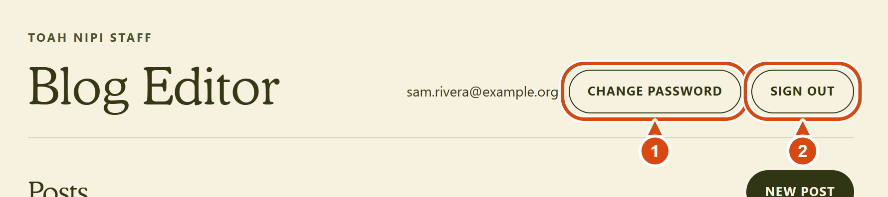

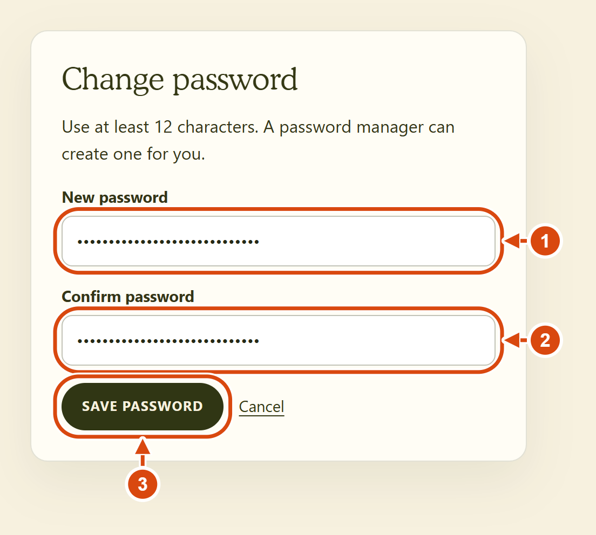

If you see a message about an "authenticator app from the earlier setup", ask the site administrator to clear it. Then try again.

### Signing out

Click **Sign out** (2 in the picture above). Always sign out when you finish, especially on a shared computer.

---

## 3. Creating a post

1. Click **New post** (1).

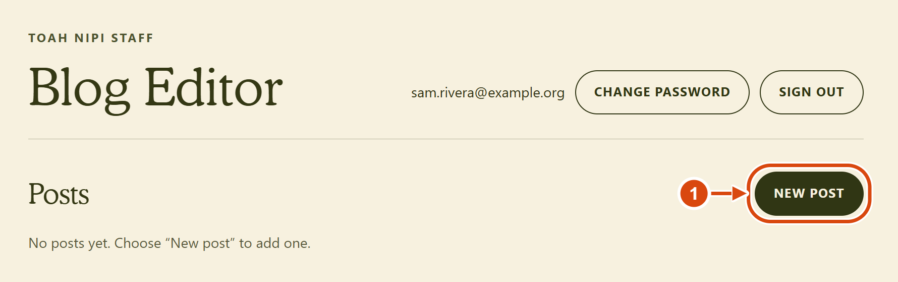

2. In **Title** (1), type the name of the post, for example "Sample Retreat Update". It can be up to 150 characters, on one line.
3. In **Short description** (2), type one or two sentences about the post. This is optional and can be up to 500 characters. The label counts down how many characters you have left. The description appears under the title on the New! page.
4. Under **PDF**, click **Choose File** (3), then find and select your PDF on your computer. Its name appears next to the button.

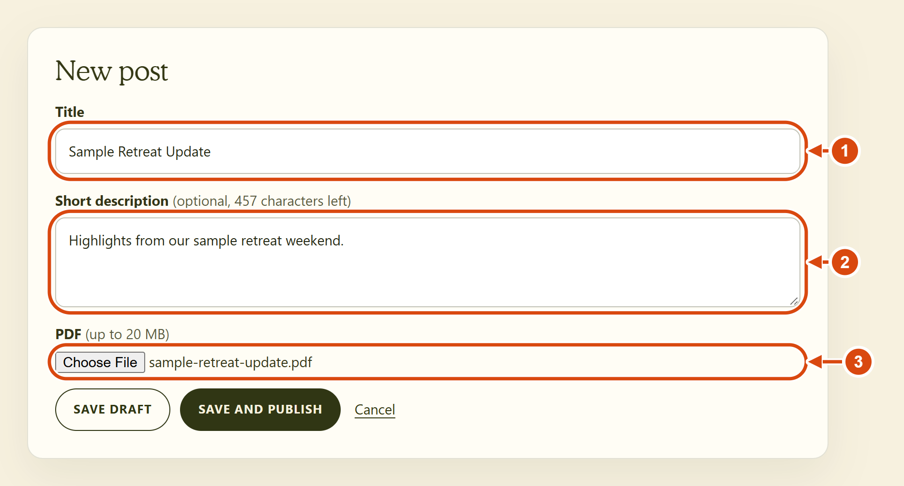

**PDF requirements:**

- It must be a PDF (a file ending in **.pdf**).
- It must be **20 MB or smaller**.
- A normal "Save as PDF" or "Download as PDF" from Canva, Word or Google Docs works. Files that are password-protected, contain attached files, fillable or interactive forms, or other unusual features are refused. The website checks every PDF and tells you if there's a problem.

**Before you continue, review your PDF.** Open it and check it's the right file and the final version: spelling, dates, names, prices and photos. Make sure it contains nothing private, such as guests' personal details, and that everyone pictured is happy to appear on the website.

Next, choose either **Save draft** (see [Saving a draft](#4-saving-a-draft)) or **Save and publish** (see [Publishing](#5-publishing)).

---

## 4. Saving a draft

A draft is saved privately. **Visitors can't see drafts.**

1. Fill in the post as described above.
2. Click **Save draft** (1).

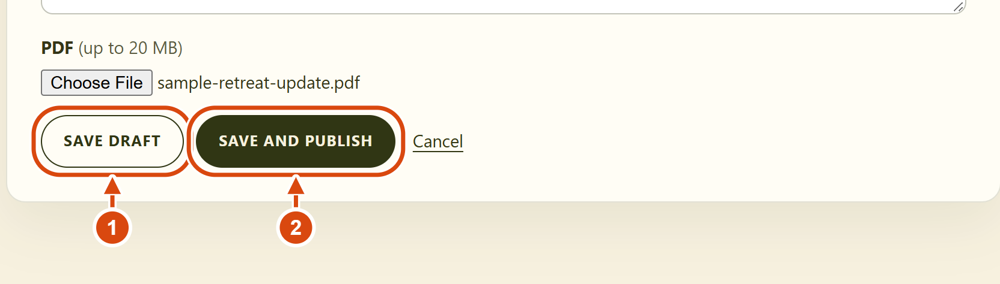

You'll return to the **Posts** list with a green message such as "Saved "Sample Spring Work Day"."

**Finding and reopening a draft:** drafts have a **Draft** label (1) and a dashed border.

- To keep working on it, click **Edit** (2). The form opens with everything you saved, including the current PDF.
- When it's ready, click **Publish** (3), or open it with **Edit** and click **Save and publish**.

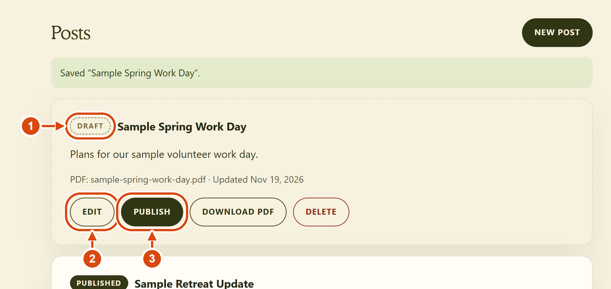

A draft needs a PDF before it can be published. Until it has one, its **Publish** button is greyed out.

---

## 5. Publishing

1. Fill in the post as described in [Creating a post](#3-creating-a-post).
2. Click **Save and publish** (2 in the picture in [Saving a draft](#4-saving-a-draft)).
3. Wait while the editor saves your post. You'll see "Uploading PDF…" with a progress bar, then "Checking the PDF…". This usually takes a few seconds. Don't close the page.

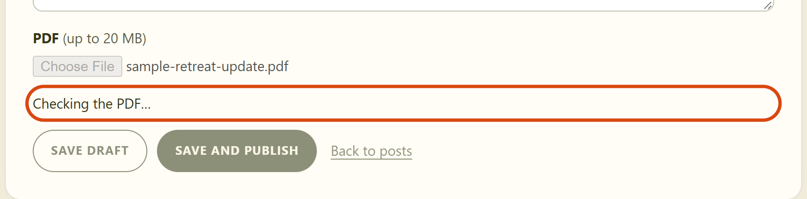

4. When it's done, you'll see a green message (1) such as ""Sample Retreat Update" is now on the website." The post shows a green **Published** label (2).

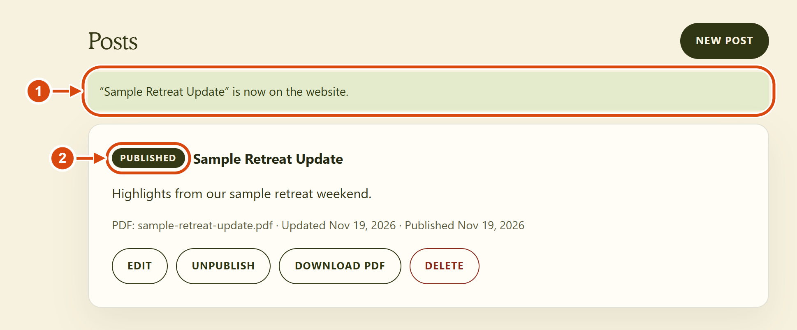

### Checking your post on the website

1. Go to **toahnipi.org/new** (the **New!** page in the menu). The newest post appears first, under **Latest Story**.
2. Find your post and click **Read Story** (1).

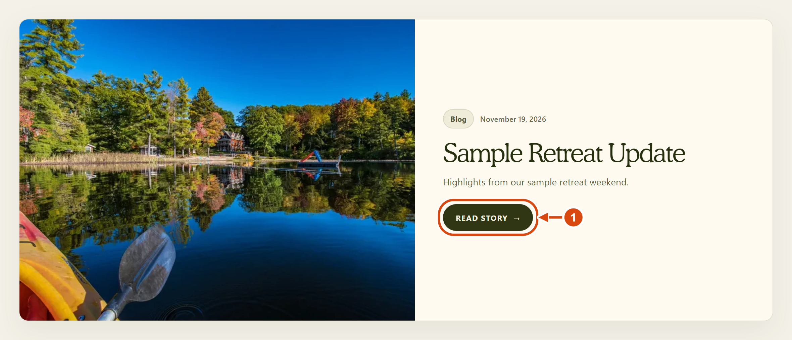

3. Your PDF opens on the page. Scroll to read it. Click **Close** (2) when you're done.

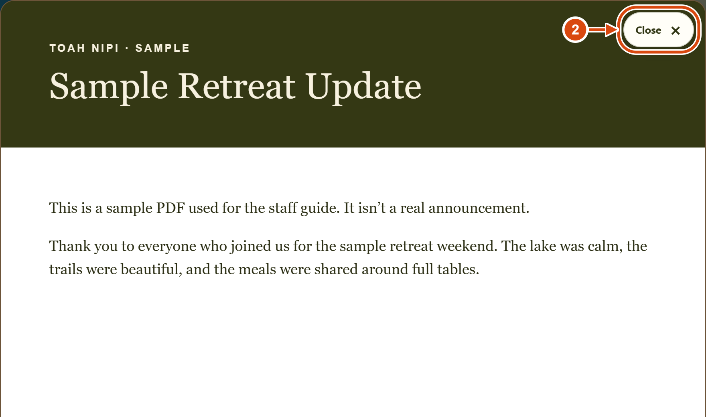

Staff posts appear with the label **Blog** and a standard Toah Nipi lake photo. You can't choose a different photo.

To check the exact PDF that's on the website, click **Download PDF** on the post in your Posts list. It saves a copy to your computer.

---

## 6. Editing a published post

1. In the **Posts** list, click **Edit** on the post.
2. To change the wording, edit the **Title** or **Short description** (1).
3. To change the PDF, click **Choose File** under **Replace PDF** (2) and pick the new file. The form shows the current file's name.
4. Click **Save changes** (3).

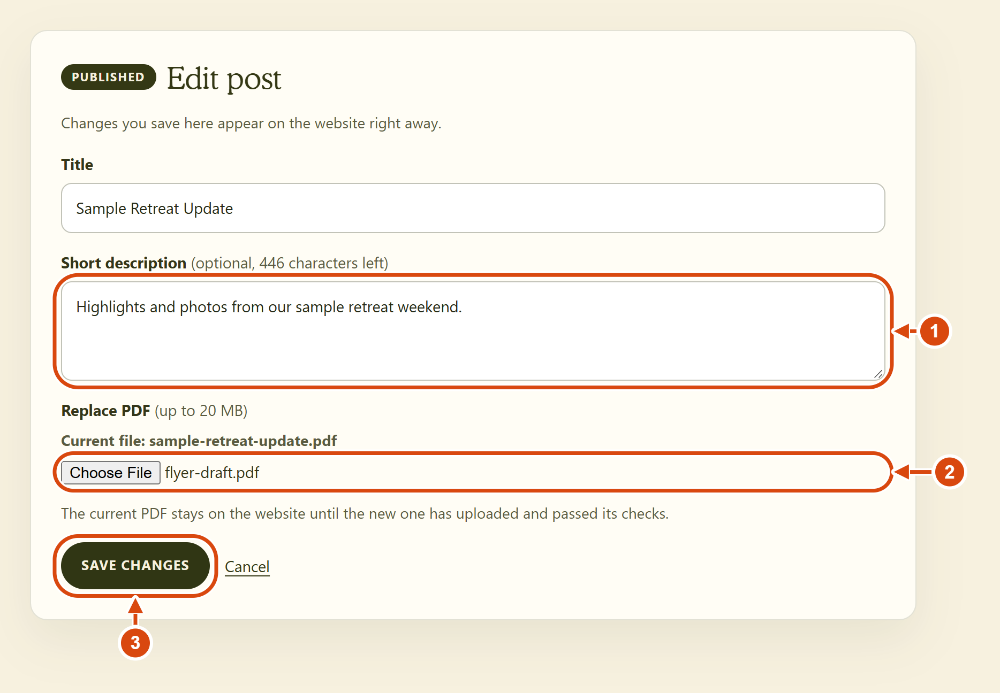

Changes to a published post appear on the website **right away**.

### If the new PDF isn't accepted

If there's a problem with the new file, a red message (1) explains what's wrong. For example: "This PDF looks incomplete or damaged. Please export it again."

**Nothing on the website has changed.** The old PDF is still live (2, **Current file**), and your typed changes stay in the form. Export a fresh copy of the PDF, choose it again, and click **Save changes**.

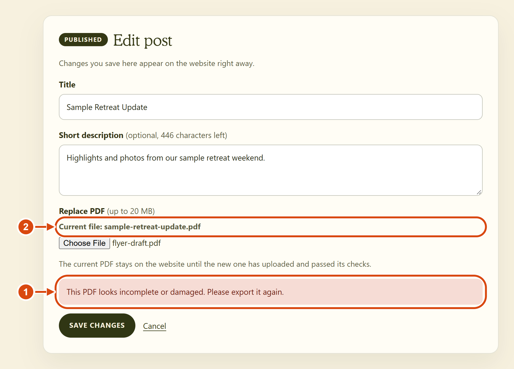

When the replacement works, you'll see a green "Saved" message (1), and the post shows the new file's name (2).

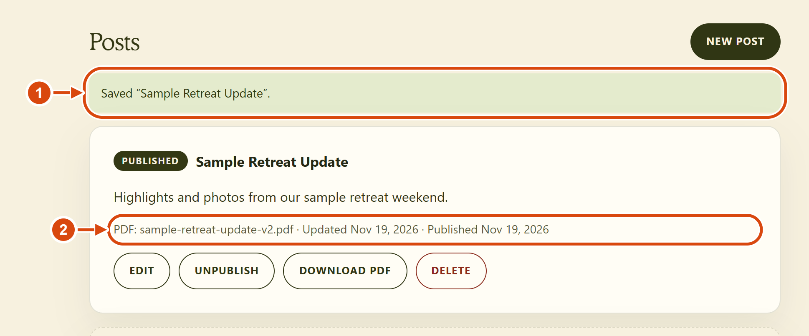

---

## 7. Unpublishing

Unpublishing takes a post off the website **but keeps it** in your Posts list as a draft. You can change it and publish it again later.

1. In the **Posts** list, find the published post.
2. Click **Unpublish** (1).

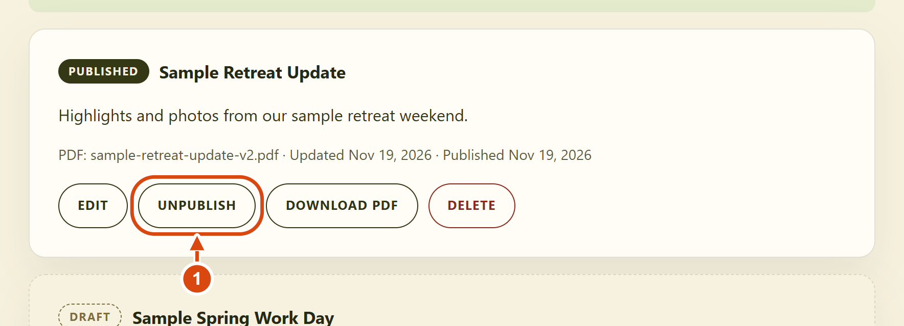

3. You'll see a green message (1): ""Sample Retreat Update" is now a draft and hidden from the website." The label changes to **Draft** (2).

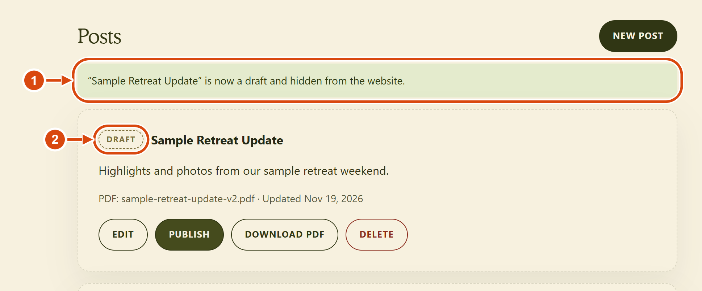

The post disappears from the New! page straight away. To put it back, click **Publish**.

---

## 8. Deleting

**Delete is permanent.** It removes the post and its PDF, and **there is no undo**. If you might want the post again, use **Unpublish** instead.

1. In the **Posts** list, find the post.
2. Click **Delete** (1). It's the button with red writing.

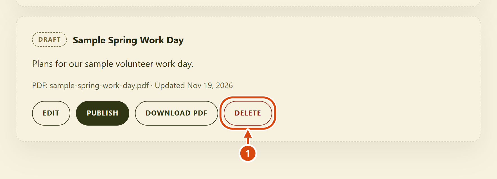

3. Your browser shows a small confirmation box. For a published post it says:
   "Delete "Sample Retreat Update"? It will be removed from the website. This can't be undone."
   For a draft it says:
   "Delete the draft "Sample Spring Work Day"? This can't be undone."
4. Click **OK** to delete it, or **Cancel** to keep it. This box looks slightly different in each browser, so there's no picture of it here.
5. You'll see a green message (1), for example "Deleted "Sample Spring Work Day"."

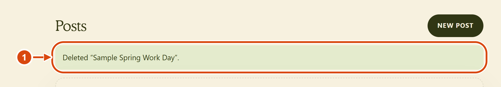

**Recovering a deleted post:** you can't restore it from the editor. To post it again, create a new post and upload the PDF again from your own computer. Keep your original PDF files somewhere safe.

---

## 9. Using a phone

The editor works on a phone. Everything is stacked in one column, and buttons move onto extra rows when they don't fit.

**The Staff link** is at the very bottom of the page, below the address and contact details.

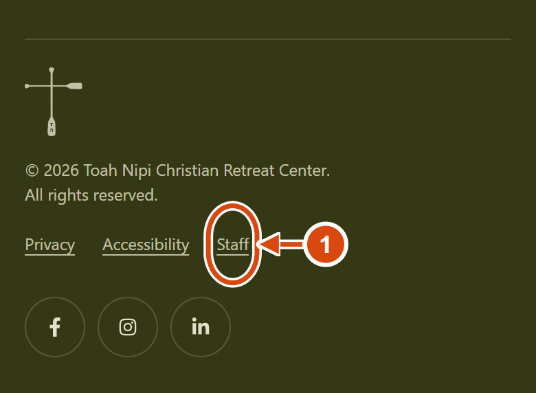

**Creating a post on a phone:** after filling in the title and description, tap **Choose File** (1). Depending on your phone, you can then pick a PDF from your files, downloads or cloud storage. Then tap **Save and publish** (2).

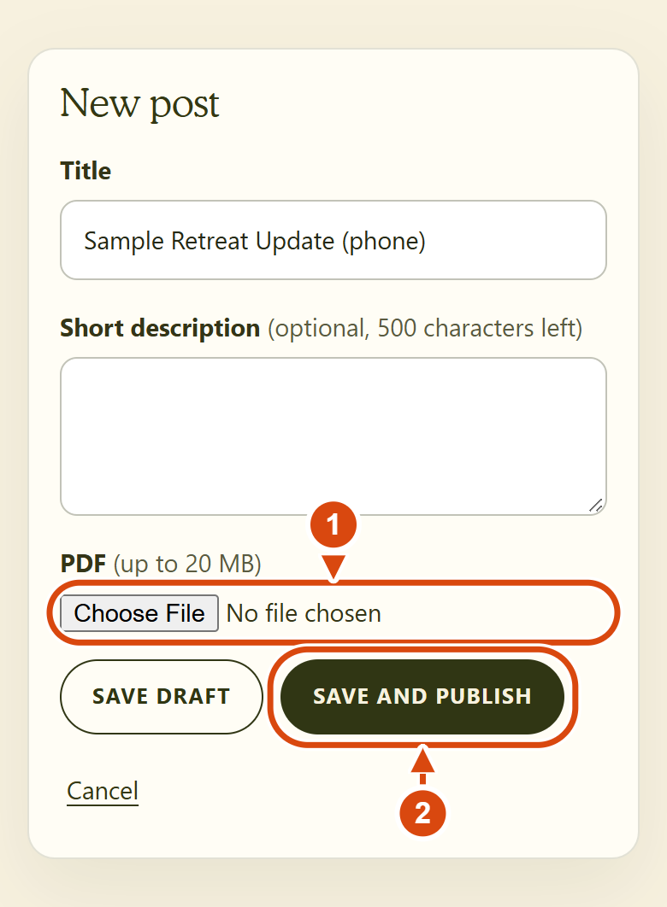

**Post buttons on a phone** wrap onto two rows (circled). They work the same as on a computer.

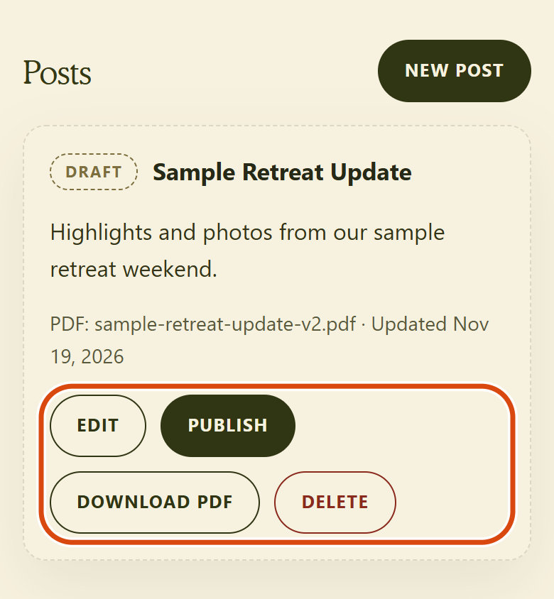

**Reading a post on a phone:** on the New! page, tap **Read Story** (1).

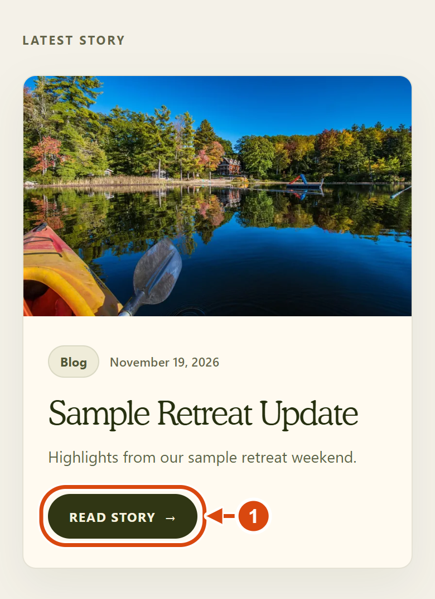

---

## 10. Troubleshooting

| What you see | What it means | What to do |
| --- | --- | --- |
| **"Incorrect email or password."** | The email or password doesn't match. | Check for typing mistakes, including capital letters. If it still fails, ask the administrator to reset your password. |
| **"This account doesn't have access to manage blog posts…"** | You're signed in, but your account isn't allowed to manage the blog. | Ask the administrator to give your account access. |
| **"Please choose a PDF file."** | The file you chose isn't a PDF. | Export or "Save as PDF" from your program and choose that file. |
| **"PDFs must be 20 MB or smaller."** | The PDF is too big. | Export it again with smaller images. Many programs, including Canva and Word, offer a smaller or "compressed" PDF option when you export. |
| **"This PDF contains…", "This PDF is password-protected", "This PDF looks incomplete or damaged…"**, or another message starting "This PDF…" | The website refused this file for safety reasons, or because it couldn't read it. | Export a fresh, ordinary PDF without passwords, attachments or form fields, and try again. If it keeps happening, send the file to the administrator. |
| **"Please enter a title."** | The Title box is empty. | Type a title. |
| **"Add a PDF before publishing."** | The post has no PDF yet. | Choose a PDF, or click **Save draft** for now. |
| **"Couldn't reach the server…"**, **"The upload was interrupted…"** or **"…Please try again."** | The internet connection dropped, or the save didn't finish. | Check your connection and click the same button again. Your typed text stays in the form. If the heading now says **New post (saved as draft)**, the post was saved; clicking again finishes it without making a second copy. If you've left the form, look for the post in your list (it may be a draft) before creating it again. |
| **"Your session expired…"** | You were signed in for a long time. | Click **Sign out**, sign in again, and repeat the last step. |
| **The post isn't on the New! page** | It's probably a draft. | In your Posts list, check whether it says **Draft** or **Published**. If it's a draft, click **Publish**. Then refresh the New! page in your browser. |
| **The PDF won't open on the New! page** | Usually a temporary connection problem. | Refresh the page and click **Read Story** again. If a "Open the story (PDF)" button appears instead, click it to download the file. If it still fails, try another browser and tell the administrator. |
| **Publish is greyed out** | The draft has no PDF. | Click **Edit**, choose a PDF and save. |

**After you unpublish or delete a post:** it disappears from the New! page straight away. But anyone who **opened the PDF in the last ten minutes** may still be able to use that same link until it expires, at most ten minutes later. Anyone who **downloaded** the PDF keeps their copy, and that can't be taken back. So check a PDF carefully before publishing.

**When to contact the site administrator:**

- You can't sign in, or you need a password reset.
- You see "This account doesn't have access…".
- The same error keeps appearing after you've tried the steps above.
- Something was published by mistake that must be removed urgently. Unpublish or delete it first, then tell the administrator.
- You deleted a post by mistake.
